# AgriShield AI: Comprehensive System Architecture

## 1. Executive System Overview

**AgriShield AI** (*Smarter Farming. Safer Crops. Better Decisions.*) is an agricultural intelligence and decision-support platform designed for Indian smallholder farmers, extension officers, and agricultural researchers.

The system combines:
1. **Verified Government Data Pipelines**: Ingestion from UPAg, OGD India, Agmarknet, IMD, and the Soil Health Card Portal.
2. **Dual-Tier Machine Learning**:
   - Edge & Server Computer Vision: Disease classification across 17 classes with quality gating, temperature scaling calibration, and Grad-CAM explainability.
   - Empirical Yield Forecasting: Tabular regression models (Linear, Random Forest, Gradient Boosting) trained on historical district-level agricultural statistics with temporal validation.
3. **Agro-Meteorological Risk Engine**: Wallin's Late Blight Severity Values (BSV) and weather stress models.
4. **Offline-First PWA Client**: Built with React 19, TypeScript, and Tailwind CSS, supporting English, Hindi, and Bengali, with on-device WebAssembly/ONNX inference and idempotent IndexedDB synchronization.

---

## 2. End-to-End Architectural Blueprint

```mermaid
flowchart TB
    subgraph Client ["Client Tier (Progressive Web Application)"]
        UI["React 19 SPA (11 Responsive Pages)"]
        i18n["Multilingual Engine (English, Bengali, Hindi)"]
        SW["Service Worker (Asset & Offline Caching)"]
        IDB[("IndexedDB (Offline Scans, Soil Tests & Sync Queue)")]
        subgraph Edge_Compute ["Edge Inference Engine"]
            WW["Dedicated Web Worker (inference.worker.ts)"]
            ORT_WASM["ONNX Runtime Web (WASM / WebGL)"]
            QuantModel["Quantized Disease Model (.onnx)"]
        end
    end

    subgraph IngestionTier ["Data Ingestion & Provenance Tier"]
        UPAgPipe["UPAg / DES Yield Harvester"]
        AgmarknetPipe["Agmarknet Mandi Price Harvester"]
        IMDPipe["IMD & Open-Meteo Weather Syncer"]
        SchemePipe["Govt Schemes Editorial Registry"]
        SHCPipe["Soil Health Card Standards Engine"]
    end

    subgraph Gateway ["API Gateway & Security Tier"]
        ReverseProxy["Nginx / Caddy Reverse Proxy"]
        RateLimiter["IP Rate Limiter & Token Bucket"]
        CorsGuard["CORS & Request Sanitizer"]
    end

    subgraph Backend ["Application Tier (FastAPI Rest Services)"]
        API["FastAPI App (/api/v1)"]
        AuthSvc["Auth & RBAC (Argon2id + JWT)"]
        SyncSvc["Idempotent Offline Sync Engine"]
        
        subgraph DomainServices ["Domain Services"]
            DiseaseSvc["Disease Classifier & Grad-CAM Service"]
            YieldSvc["Empirical Yield Forecasting Service"]
            WeatherSvc["Weather & Agro-Risk Engine (BSV)"]
            MandiSvc["Mandi Price & Arrival Analytics"]
            SoilSvc["Soil Health Diagnostic & Amelioration"]
            SchemeSvc["Government Schemes Discovery"]
            ReportSvc["Farmer Dossier & Report Exporter"]
        end
    end

    subgraph StorageTier ["Persistence & Model Storage Tier"]
        RDBMS[("Relational Database (PostgreSQL / SQLite)")]
        MediaStore[("Media Store (Uploaded Images & Heatmaps)")]
        ModelRegistry[("Versioned ML Model Registry")]
    end

    %% Client Data Flow
    UI <--> i18n
    UI <--> SW
    UI <--> IDB
    UI --> WW
    WW --> ORT_WASM
    ORT_WASM --> QuantModel
    UI -- "HTTPS REST (When Online)" --> ReverseProxy

    %% Gateway to Backend
    ReverseProxy --> RateLimiter --> CorsGuard --> API

    %% Backend to Domain Services
    API --> AuthSvc
    API --> SyncSvc
    API --> DiseaseSvc
    API --> YieldSvc
    API --> WeatherSvc
    API --> MandiSvc
    API --> SoilSvc
    API --> SchemeSvc
    API --> ReportSvc

    %% External Ingestion to Storage
    UPAgPipe --> RDBMS
    AgmarknetPipe --> RDBMS
    IMDPipe --> RDBMS
    SchemePipe --> RDBMS
    SHCPipe --> RDBMS

    %% Backend to Storage
    AuthSvc --> RDBMS
    SyncSvc --> RDBMS
    DiseaseSvc --> MediaStore
    DiseaseSvc --> ModelRegistry
    YieldSvc --> ModelRegistry
    ReportSvc --> RDBMS
```

---

## 3. Subsystem Specifications

### 3.1 Client Tier (PWA & 11 Modular Pages)
- **Framework**: React 19, TypeScript (strict mode), Vite 6, Tailwind CSS.
- **Languages**: English (`en`), Bengali (`bn`), Hindi (`hi`) via `react-i18next`.
- **11 Responsive Views**:
  1. `LandingPage`: Platform overview, verified source badges, quick CTA.
  2. `OnboardingPage`: Farmer profile, language, district, crops cultivated.
  3. `DashboardPage`: Weather card, mandi ticker, recent scan status, quick actions.
  4. `DiseasePage`: Image upload, blur detection, inference, Grad-CAM, extension contact.
  5. `YieldPage`: Historical statistics, Random Forest yield prediction, confidence intervals.
  6. `WeatherPage`: 5-day forecast, rainfall anomalies, late blight risk meters.
  7. `MandiPage`: Multi-mandi price spread, modal rates, arrival volume charts.
  8. `SoilPage`: Soil Health Card test entry, fertility index, crop suitability.
  9. `SchemesPage`: Searchable directory of Central & West Bengal schemes.
  10. `ReportsPage`: Consolidated farmer assessment reports with PDF export.
  11. `SettingsPage`: Language switch, offline cache control, data export/purge.

### 3.2 Machine Learning Tier
1. **Module A: Disease Screening**:
   - Model: MobileNetV3-Large / EfficientNet-B0 with custom bottleneck head.
   - Temperature scaling post-calibration (ECE reduced to $< 0.05$).
   - Energy-based Out-of-Distribution (OOD) gating to flag non-leaf inputs.
   - Grad-CAM heatmap generation at the final convolutional feature map.
2. **Module B: Yield Forecasting**:
   - Target: Yield ($\text{tonnes/ha}$) from official UPAg/DES datasets.
   - Features: District, Crop, Season, Cultivated Area, Seasonal Rainfall, Mean Temperature.
   - Evaluated algorithms: Historical baseline, Ridge Regression, Random Forest Regressor, Gradient Boosting.
   - Temporal validation split ($2000-2017$ train; $2018-2022$ holdout evaluation).

### 3.3 Data Ingestion & Governance Tier
- **Data Source Registry**: Maintained in database and documented in `docs/dataset-inventory.md`.
- **Freshness Monitoring**: Each external dataset records its retrieval timestamp and synchronization status. If a source is unreachable, the system gracefully falls back to the local cached dataset and notifies the user with a data freshness warning badge.
- **Zero Fabrication Guarantee**: Synthetic data is restricted strictly to automated tests; real database tables contain verified records.
