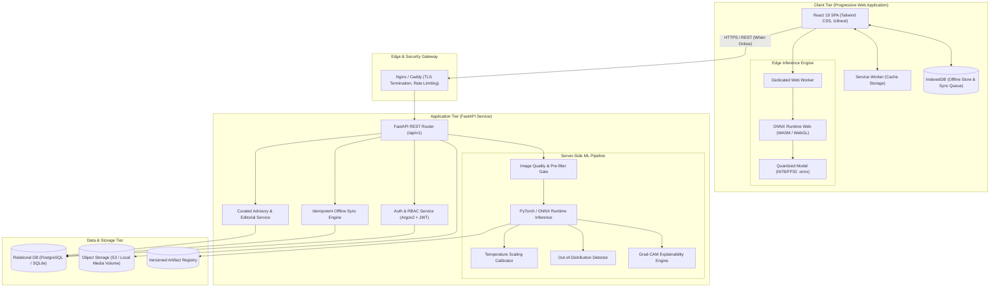

# AgriShield AI System Architecture

## 1. Executive Overview

AgriShield AI is designed as a hybrid edge-cloud, production-grade crop disease screening and agronomic advisory platform. It bridges the gap between deep learning research and practical agricultural utility for smallholder farmers. The platform operates on an offline-first principle: screening can occur in remote fields without cellular connectivity, while syncing securely with a cloud-native FastAPI backend and relational database once connectivity is restored.

---

## 2. End-to-End Architectural Blueprint



---

## 3. Tier-by-Tier Specifications

### 3.1 Client Tier (PWA & Edge Inference)
- **Framework**: React 19, TypeScript (strict mode), Vite 6, Tailwind CSS.
- **State Management & Routing**: React Router v7, Zustand for global UI & sync states.
- **Multilingual Support (`i18next`)**: English (`en`), Bengali (`bn`), Hindi (`hi`) with native script fallbacks (`Noto Sans Bengali`, `Noto Sans Devanagari`).
- **Offline Storage**: IndexedDB accessed via `Dexie.js`:
  - Store `pending_scans`: Scans captured while offline with client-generated RFC 4122 UUIDs.
  - Store `cached_advisories`: Pre-fetched curated disease guidelines for offline reading.
  - Store `cached_models`: Model binary and metadata cached under Cache API and IndexedDB.
- **On-Device Inference Pipeline**:
  - Offloaded to a dedicated Web Worker (`inference.worker.ts`) to maintain 60 FPS UI responsiveness.
  - Runtime: `onnxruntime-web` leveraging WebAssembly SIMD or WebGL.
  - Preprocessing in worker: 224x224 bilinear resize, ImageNet normalization ($\mu = [0.485, 0.456, 0.406]$, $\sigma = [0.229, 0.224, 0.225]$).

### 3.2 Backend Tier (FastAPI Service)
- **Framework**: Python 3.12, FastAPI, Pydantic v2.
- **Data Persistence**: SQLAlchemy 2.0 ORM with Alembic migrations.
- **Database**: PostgreSQL in staging/production, SQLite for isolated unit testing and local lightweight development.
- **Security & Authorization**:
  - Password Hashing: Argon2id (`passlib[argon2]`).
  - Stateless Token Strategy: Short-lived HMAC-SHA256 JWT Access Tokens (15 min) + Refresh Tokens (7 days).
  - Row-Level Ownership: Every scan and farm operation strictly verifies tenant ownership (`current_user.id == record.user_id`).
  - Rate Limiting: 60 requests/min per IP on general endpoints, 10 requests/min on `/auth` and `/predict`.
  - Image Sanitation: Verification of magic bytes, PIL decompression bomb limit set to 20 Megapixels, strip EXIF metadata for privacy.

### 3.3 Reliability, Uncertainty & Decision States

Rather than outputting naive uncalibrated softmax scores, AgriShield AI computes a structured diagnostic state across three discrete channels:

```
Raw Image
   │
   ▼
[ 1. Image Quality Gate ] ──(Fails blur/exposure)──► REJECTED: "Image unclear. Retake with steady focus."
   │ Passes
   ▼
[ 2. Crop Compatibility & OOD Gate ] ──(High OOD distance)──► REJECTED: "Non-crop / unsupported input."
   │ In-Distribution
   ▼
[ 3. Deep Feature Extractor & Calibrated Classifier ]
   │
   ├─► High Calibrated Softmax Confidence (≥ 0.82) ──► STATE: CONFIDENT RESULT
   │                                                    • Primary prediction + Grad-CAM heatmap
   │                                                    • Curated prevention & treatment guidance
   │
   └─► Ambiguous Softmax (0.45 ≤ Conf < 0.82)      ──► STATE: UNCERTAIN RESULT
                                                        • Top-3 differential predictions
                                                        • Visual disclaimer
                                                        • Direct referral to Extension Officer
```

---

## 4. Curated Advisory Knowledge Base Model

To prevent dangerous or hallucinated agricultural advice:
- Disease descriptions, biological symptoms, cultural management, and preventive steps are stored in structured JSON/relational tables.
- Each advisory record tracks:
  - `crop_name`: Tomato, Potato, Corn.
  - `disease_key`: Unique machine class name.
  - `language`: `en`, `bn`, `hi`.
  - `symptoms`: Verified field identifiers.
  - `prevention`: Cultural sanitation, crop rotation, soil drainage, resistant varieties.
  - `chemical_management`: Fixed reference to certified local agronomical authorities (no invented active ingredients or dosages).
  - `source_reference`: ICAR / State Agricultural University extension publication URL.
  - `editorial_status`: `draft`, `reviewed`, `published`.
  - `reviewed_by`: Name and affiliation of agronomist.
  - `review_date`: ISO 8601 UTC timestamp.

---

## 5. Performance & Resource Budgets

| Metric | Edge Target (Mobile PWA) | Server Target (FastAPI) |
| :--- | :--- | :--- |
| Model Size (Disk/Cache) | $< 15\text{ MB}$ (INT8 ONNX) | $< 40\text{ MB}$ (FP32 ONNX/PyTorch) |
| Cold Start Latency | $< 800\text{ ms}$ (Model load) | $< 150\text{ ms}$ |
| Inference Latency | $< 250\text{ ms}$ (Mid-tier mobile WASM) | $< 60\text{ ms}$ (CPU) / $< 15\text{ ms}$ (GPU) |
| Memory Footprint | $< 70\text{ MB}$ RAM | $< 250\text{ MB}$ per worker |
| Quality Check Latency | $< 35\text{ ms}$ (Laplacian + Exposure) | $< 15\text{ ms}$ |
| Network Payload (Sync) | $< 1.2\text{ MB}$ per compressed scan | Batch endpoints compressed via gzip |
