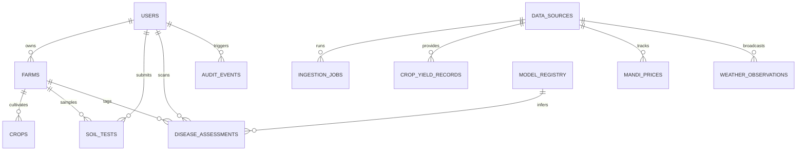

# AgriShield AI: Data Dictionary & Normalized Database Schema

This document details the complete relational schema, data dictionary, unit conventions, and indexing strategies for the **AgriShield AI** platform.

---

## 1. Schema Entity Relationship Architecture

---

## 2. Table Specifications & Data Dictionary

### 2.1 Core Identity & User Preferences

#### Table: `users`
| Column Name | Data Type | Nullable | Default | Description |
| :--- | :--- | :---: | :---: | :--- |
| `id` | VARCHAR(36) | NO | UUIDv4 | Primary Key |
| `email` | VARCHAR(255) | NO | - | Unique login email address |
| `password_hash` | VARCHAR(255) | NO | - | Argon2id password hash |
| `full_name` | VARCHAR(120) | NO | - | Full name of the farmer / extension officer |
| `phone_number` | VARCHAR(20) | YES | NULL | Optional contact number (10-digit Indian standard) |
| `role` | VARCHAR(20) | NO | 'farmer' | User role: `farmer`, `extension_worker`, `researcher`, `admin` |
| `preferred_language`| VARCHAR(5) | NO | 'en' | Preferred UI language: `en`, `bn`, `hi` |
| `state` | VARCHAR(60) | YES | 'West Bengal'| State of primary operation |
| `district` | VARCHAR(60) | YES | NULL | District of primary operation |
| `created_at` | TIMESTAMP | NO | CURRENT_TIMESTAMP | Account creation timestamp |
| `updated_at` | TIMESTAMP | NO | CURRENT_TIMESTAMP | Last modification timestamp |

#### Table: `farms`
| Column Name | Data Type | Nullable | Default | Description |
| :--- | :--- | :---: | :---: | :--- |
| `id` | VARCHAR(36) | NO | UUIDv4 | Primary Key |
| `user_id` | VARCHAR(36) | NO | - | Foreign Key $\to$ `users.id` (ON DELETE CASCADE) |
| `farm_name` | VARCHAR(100) | NO | - | Identifier (e.g., "North Field Plot 2") |
| `state` | VARCHAR(60) | NO | 'West Bengal'| Indian State |
| `district` | VARCHAR(60) | NO | - | District (e.g., 'Purba Bardhaman') |
| `sub_district` | VARCHAR(60) | YES | NULL | Block / Tehsil |
| `village` | VARCHAR(100) | YES | NULL | Village name |
| `latitude` | FLOAT | YES | NULL | Verified centroid latitude |
| `longitude` | FLOAT | YES | NULL | Verified centroid longitude |
| `total_area_hectares`| FLOAT | NO | 1.0 | Cultivated land area in Hectares |
| `irrigation_type` | VARCHAR(40) | NO | 'Canal/Borewell'| Canal, Tube-well, Drip, Rainfed |
| `created_at` | TIMESTAMP | NO | CURRENT_TIMESTAMP | Creation timestamp |

---

### 2.2 Agricultural Intelligence & Official Data Entities

#### Table: `crop_yield_records`
*Stores verified historical district-level crop area, production, and empirical yields from UPAg and DES.*
| Column Name | Data Type | Nullable | Description |
| :--- | :--- | :---: | :--- |
| `id` | VARCHAR(36) | NO | Primary Key (UUIDv4) |
| `state` | VARCHAR(60) | NO | State name (indexed) |
| `district` | VARCHAR(60) | NO | District name (indexed) |
| `crop_year` | INTEGER | NO | Agricultural year (e.g., 2021) |
| `season` | VARCHAR(30) | NO | Kharif, Rabi, Summer, Whole Year |
| `crop` | VARCHAR(60) | NO | Commodity (Rice, Potato, Maize, Tomato, etc.) |
| `area_hectares` | FLOAT | NO | Cultivated area in hectares |
| `production_tonnes` | FLOAT | NO | Total production in metric tonnes |
| `yield_tonnes_per_hectare` | FLOAT | NO | $\frac{\text{Production}}{\text{Area}}$ (Derived & validated) |
| `rainfall_seasonal_mm` | FLOAT | YES | Total cumulative seasonal rainfall in mm |
| `mean_temp_celsius` | FLOAT | YES | Mean seasonal ambient temperature |
| `source_id` | VARCHAR(40) | NO | Data source tag (e.g., `UPAG_DES_WB_2024`) |
| `created_at` | TIMESTAMP | NO | Ingestion timestamp |

#### Table: `mandi_prices`
*Stores verified spot transactions and arrival volumes from Agmarknet.*
| Column Name | Data Type | Nullable | Description |
| :--- | :--- | :---: | :--- |
| `id` | VARCHAR(36) | NO | Primary Key |
| `state` | VARCHAR(60) | NO | State name (e.g., 'West Bengal') |
| `district` | VARCHAR(60) | NO | District name |
| `market_name` | VARCHAR(100) | NO | Wholesale mandi name (e.g., 'Kalna', 'Burdwan') |
| `commodity` | VARCHAR(60) | NO | Crop commodity (Potato, Tomato, etc.) |
| `variety` | VARCHAR(60) | YES | Commercial variety (e.g., 'Jyoti', 'Deshi') |
| `arrival_date` | DATE | NO | Trading session date (indexed) |
| `min_price` | FLOAT | NO | Minimum price in ₹ per Quintal (100 kg) |
| `max_price` | FLOAT | NO | Maximum price in ₹ per Quintal |
| `modal_price` | FLOAT | NO | Modal (most frequent) price in ₹ per Quintal |
| `arrivals_volume` | FLOAT | NO | Volume arrived in Quintals |
| `source_timestamp`| TIMESTAMP | NO | Official report recording timestamp |

#### Table: `weather_observations`
*Captures verified observations and 5-day agro-met forecasts.*
| Column Name | Data Type | Nullable | Description |
| :--- | :--- | :---: | :--- |
| `id` | VARCHAR(36) | NO | Primary Key |
| `district` | VARCHAR(60) | NO | District name |
| `observation_date`| DATE | NO | Observation or forecast date |
| `is_forecast` | BOOLEAN | NO | False = Ground station record; True = 5-day forecast |
| `temp_max_celsius`| FLOAT | NO | Maximum daily temperature |
| `temp_min_celsius`| FLOAT | NO | Minimum daily temperature |
| `relative_humidity_pct`| FLOAT | NO | Relative humidity percentage ($0-100\%$) |
| `precipitation_mm`| FLOAT | NO | Daily rainfall accumulation |
| `wind_speed_kmh` | FLOAT | NO | Wind speed in km/h |
| `alert_level` | VARCHAR(20) | NO | 'None', 'Green', 'Yellow', 'Orange', 'Red' |
| `alert_advisory` | TEXT | YES | Official weather advisory text |
| `source_name` | VARCHAR(60) | NO | 'IMD_AGROMET' or 'OPEN_METEO_REANALYSIS' |

#### Table: `soil_tests`
*Stores farmer soil analysis according to Soil Health Card guidelines.*
| Column Name | Data Type | Nullable | Description |
| :--- | :--- | :---: | :--- |
| `id` | VARCHAR(36) | NO | Primary Key |
| `user_id` | VARCHAR(36) | NO | Foreign Key $\to$ `users.id` |
| `farm_id` | VARCHAR(36) | YES | Optional Foreign Key $\to$ `farms.id` |
| `sample_date` | DATE | NO | Date of soil sample collection |
| `ph` | FLOAT | NO | Soil reaction ($0-14$) |
| `electrical_conductivity`| FLOAT | NO | EC in dS/m |
| `organic_carbon_pct` | FLOAT | NO | Organic Carbon percentage ($0-5\%$) |
| `available_nitrogen` | FLOAT | NO | Available N in kg/ha |
| `available_phosphorus`| FLOAT | NO | Available P in kg/ha |
| `available_potassium` | FLOAT | NO | Available K in kg/ha |
| `fertility_rating` | VARCHAR(20) | NO | 'Low', 'Medium', 'High', 'Imbalanced' |
| `recommendations_json`| JSON | NO | Amelioration advice & fertilizer guidelines |
| `created_at` | TIMESTAMP | NO | Ingestion timestamp |

#### Table: `disease_assessments`
*Records computer vision leaf diagnostic screening sessions with full provenance.*
| Column Name | Data Type | Nullable | Description |
| :--- | :--- | :---: | :--- |
| `id` | VARCHAR(36) | NO | Primary Key (UUIDv4) |
| `user_id` | VARCHAR(36) | NO | Foreign Key $\to$ `users.id` |
| `farm_id` | VARCHAR(36) | YES | Optional Farm link |
| `client_scan_uuid` | VARCHAR(36) | NO | RFC 4122 UUID generated offline by PWA |
| `image_path` | VARCHAR(255) | NO | Path to uploaded image artifact |
| `predicted_crop` | VARCHAR(40) | NO | Tomato, Potato, Corn |
| `predicted_disease` | VARCHAR(80) | NO | Predicted pathology class name |
| `confidence_score` | FLOAT | NO | Calibrated Softmax probability ($0.0-1.0$) |
| `confidence_band` | VARCHAR(20) | NO | 'HIGH' (>0.75), 'MODERATE' (0.5-0.75), 'UNCERTAIN' (<0.5) |
| `is_uncertain` | BOOLEAN | NO | True if confidence is below calibrated threshold |
| `ood_score` | FLOAT | NO | Energy-based Out-of-Distribution metric |
| `gradcam_path` | VARCHAR(255) | YES | Path to generated Grad-CAM heatmap visualization |
| `model_version` | VARCHAR(40) | NO | Version identifier of model used for inference |
| `created_at` | TIMESTAMP | NO | Screening timestamp |

#### Table: `government_schemes`
*Curated, verified Central and West Bengal agricultural welfare schemes.*
| Column Name | Data Type | Nullable | Description |
| :--- | :--- | :---: | :--- |
| `id` | VARCHAR(40) | NO | Unique code (e.g., `PM_KISAN`, `BSB_WB`) |
| `title_en` | VARCHAR(150) | NO | English scheme title |
| `title_hi` | VARCHAR(200) | NO | Hindi scheme title |
| `title_bn` | VARCHAR(200) | NO | Bengali scheme title |
| `category` | VARCHAR(50) | NO | Insurance, Direct Benefit, Credit, Subsidies |
| `sponsoring_agency` | VARCHAR(120) | NO | Ministry / State Department |
| `official_url` | VARCHAR(255) | NO | Official government `.gov.in` portal |
| `eligibility_criteria_json`| JSON | NO | Structured requirements (land, residency, etc.) |
| `documents_required_json`| JSON | NO | Required documents (Voter ID, Land deed, etc.) |
| `last_verified_date` | DATE | NO | Last manual verification by editorial team |

---

## 3. Database Indexes

- `idx_users_email`: `users(email)` UNIQUE.
- `idx_yield_state_dist_crop`: `crop_yield_records(state, district, crop, crop_year)`.
- `idx_mandi_commodity_date`: `mandi_prices(state, district, commodity, arrival_date)`.
- `idx_weather_dist_date`: `weather_observations(district, observation_date)`.
- `idx_scans_user_time`: `disease_assessments(user_id, created_at DESC)`.
- `idx_scans_client_uuid`: `disease_assessments(client_scan_uuid)` UNIQUE (ensures idempotent sync).
