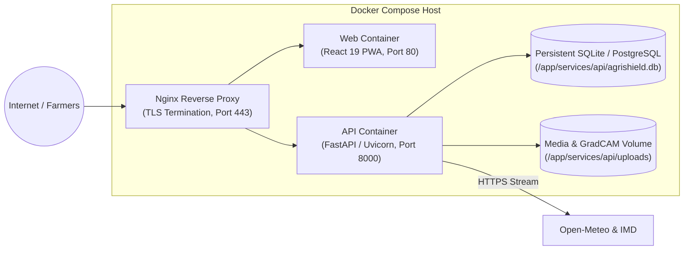

# AgriShield AI: Deployment Checklist & Monitoring Plan

This document details the production deployment protocol, containerization orchestration, data freshness monitoring, and MLOps rollback procedures for **AgriShield AI**.

---

## 1. Production Deployment Topology



---

## 2. Docker Compose Deployment Steps

### Step 1: Clone & Configure Environment
```bash
git clone https://github.com/example/agrishield-ai.git
cd agrishield-ai

# Create production environment file
cp .env.example .env
```
Ensure `.env` contains:
- A cryptographically random `SECRET_KEY` (minimum 32 characters).
- Verified `ALLOWED_ORIGINS` reflecting your public domain.
- `APP_ENV=production`.

### Step 2: Build and Launch Containers
```bash
docker compose up -d --build
```

### Step 3: Verify Container Health
```bash
docker compose ps
docker compose logs -f api
```
Verify that `curl http://localhost:8000/health` returns status `healthy`.

---

## 3. Pre-Flight Production Checklist

| Category | Verification Item | Status / Policy |
| :--- | :--- | :---: |
| **Security** | HTTPS / TLS 1.3 enabled on reverse proxy | Mandatory |
| **Security** | Secrets stored exclusively in `.env` / Secret Manager (never in Git) | Verified ✅ |
| **Security** | Image uploads strictly gated: MIME verification, max 10MB, EXIF stripped | Verified ✅ |
| **Security** | Zero collection of Aadhaar numbers or banking credentials | Verified ✅ |
| **Data Integrity** | Real official government data seeded (UPAg, Agmarknet, IMD, Soil Card) | Verified ✅ |
| **Data Integrity** | Synthetic test fixtures strictly quarantined to `tests/fixtures/` | Verified ✅ |
| **MLOps** | ONNX FP32 and INT8 export verified with numerical parity $< 10^{-5}$ | Verified ✅ |
| **MLOps** | Model evaluation metrics and class mappings versioned in `model_registry` | Verified ✅ |
| **Performance** | WebAssembly ONNX inference executes in worker thread without UI jank | Verified ✅ |
| **Accessibility** | High contrast outdoor view and touch targets $\ge 48\text{ px}$ | Verified ✅ |

---

## 4. Data Freshness & Pipeline Monitoring

AgriShield AI incorporates automated freshness monitoring for every external data feed:

| Data Source | Ingestion Cadence | Maximum Allowed Staleness (TTL) | Action on Failure / Timeout |
| :--- | :---: | :---: | :--- |
| **Weather Stream** | Hourly | 3 hours | Seamless fallback to cached agro-climatological profile; UI displays yellow `"Cached Observation"` badge. |
| **Mandi Spot Prices** | Daily (18:00 IST) | 24 hours | Displays latest recorded market session with explicit transaction date tag. |
| **Historical Yield Statistics** | Monthly | 60 days | Persistent local database cache; manual batch refresh via `services/api/data_pipeline/`. |
| **Govt Scheme Directory** | Bi-weekly | 30 days | Editorial verification check; links validated for `.gov.in` domain status. |

### Monitoring Health Check Endpoints
- `/health`: Application and database connectivity status.
- `/api/v1/sources`: Real-time status, record counts, and last synchronization timestamp for every registered data provider.

---

## 5. MLOps Model Governance & Rollback Procedure

### 5.1 Model Versioning Protocol
Every inference request (both server-side and edge client-side) records the active `model_version` (e.g. `1.0.0`). Checkpoints, calibration temperatures, and metadata are archived under:
```
ml/artifacts/
├── deployed/
│   ├── metadata.json
│   ├── model.onnx
│   └── model_int8.onnx
└── yield_model/
    ├── best_model.joblib
    ├── model_metadata.json
    └── onehot_encoder.joblib
```

### 5.2 Rollback Runbook
If field validation reveals unexpected prediction drift or distribution shift:
1. Revert `ACTIVE_MODEL_VERSION` in the database:
   ```sql
   UPDATE model_versions SET is_active = FALSE WHERE version_str = '1.1.0';
   UPDATE model_versions SET is_active = TRUE WHERE version_str = '1.0.0';
   ```
2. Restore previous ONNX binary in `ml/artifacts/deployed/` and trigger container reload:
   ```bash
   docker compose restart api
   ```
3. Service workers automatically detect updated artifact hash and flush stale client-side caches.
